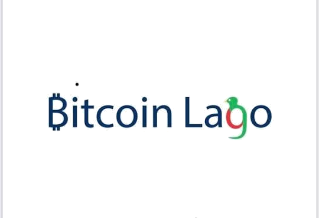
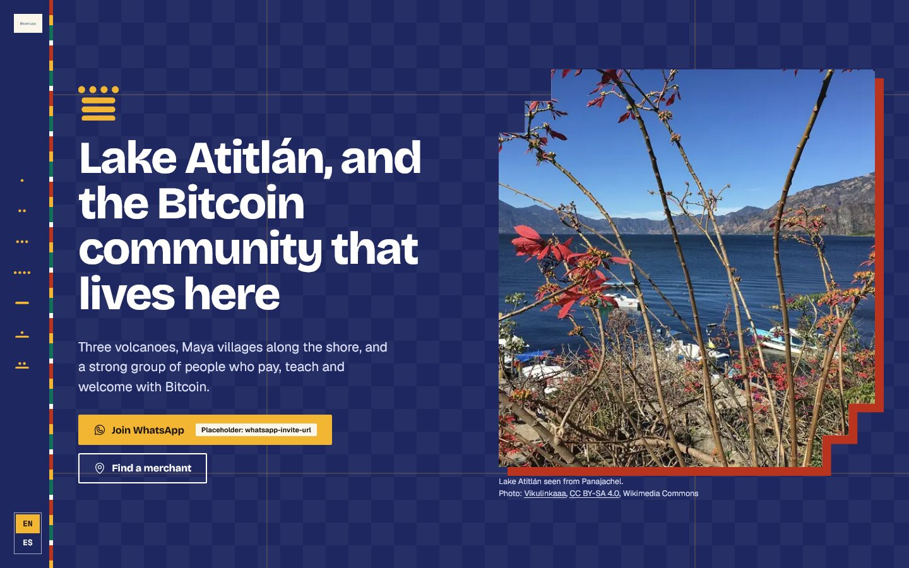
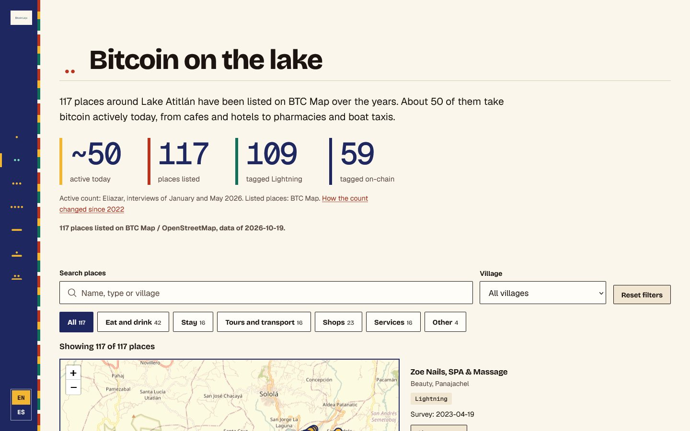

<picture>
  <source media="(prefers-color-scheme: dark)" srcset="images/logo/lago-bitcoin-logo-light.png">
  
</picture>

# Bitcoin Lago 🌋🟠

**The Bitcoin community of Lake Atitlán, Guatemala, in English and Spanish**

Where to pay with bitcoin, how the community started, and how to join in. ⚡

[🌐 Website](https://itstomekk.github.io/bitcoin-lago/) · [🇪🇸 En español](https://itstomekk.github.io/bitcoin-lago/es/) · [📖 Our story](https://itstomekk.github.io/bitcoin-lago/story/) · [❓ Visitor FAQ](https://itstomekk.github.io/bitcoin-lago/faq/) · [🗺️ BTC Map](https://btcmap.org/community/lago-bitcoin/merchants) · [𝕏 @LakeBitcoin](https://x.com/LakeBitcoin)

 

---

## 👋 Hello!

Lake Atitlán has three volcanoes, Maya villages along the shore, and a community of people who pay, teach and welcome with Bitcoin. This repository is the code of the website that tells that story and helps visitors use bitcoin around the lake.

It is a community project. It does not claim to be an official channel of any organisation, and it credits the people and sources behind every story.

If you landed here by accident: **[open the website](https://itstomekk.github.io/bitcoin-lago/)**. Visiting the lake, living here or just curious, you are welcome. 🧡

## 🚦 Status

**Public preview, live now.** The site runs on GitHub Pages in English and Spanish. It is kept out of search engines on purpose (`noindex`, and `robots.txt` disallows crawlers) until a custom domain is chosen. A few buttons, such as the WhatsApp invite and the contact email, still show a visible "Placeholder" badge because the real links are not filled in yet.

## 🧭 What you will find

- 🗺️ **The merchant map.** 117 places around the lake listed on BTC Map (data of 2026-10-19), with search, village and category filters. The site says how many of them take bitcoin actively today and where that figure comes from.
- 🚤 **Getting around.** The Bitcoin boat, a boat taxi and three tuk tuks listed in Panajachel.
- 📖 **Our story, year by year.** A timeline from 2021 to today, every moment linked to its source.
- 🎬 **Stories and guides.** 20 articles: summaries of interviews, talks and documentaries, topic stories, and practical guides for visitors.
- ❓ **Visitor FAQ.** Paying, wallets, cash, getting around and how to help, with a source under each answer.
- 🤝 **The community.** Meetups, Bitcoin in schools, and how to get in touch.

## 💬 Where to find us

| | |
|---|---|
| 𝕏 Bitcoin Lago | [@LakeBitcoin](https://x.com/LakeBitcoin) |
| 𝕏 Local leader, meetup dates | [@JUN_AJPU_btc](https://x.com/JUN_AJPU_btc) |
| 🗺️ Places on the map | [BTC Map, Lago Bitcoin community](https://btcmap.org/community/lago-bitcoin/merchants) |
| 💡 Site issues and ideas | [GitHub issues](https://github.com/itstomekk/bitcoin-lago/issues) |

## 🙌 How to help

- 📍 **Know a place that takes bitcoin, or one that stopped?** Add or fix it on [BTC Map](https://btcmap.org/community/lago-bitcoin/merchants). Please check with the merchant first.
- ✍️ **Spotted a typo, a wrong fact or a broken link?** [Open an issue](https://github.com/itstomekk/bitcoin-lago/issues) or send a pull request.
- 🗣️ **Native Spanish speaker, or Kaqchikel or Tz'utujil speaker?** A read-through of our texts is very welcome. Please do not machine-translate: a new language only goes on the site after a native speaker has reviewed it.
- 📸 **Have photos or sources?** Tell us where they come from so we can credit them properly.

Technical notes for contributors are in [DEVELOPMENT.md](DEVELOPMENT.md).

## 📜 Credits and data

- Merchant data © [OpenStreetMap contributors](https://www.openstreetmap.org/copyright) (ODbL), as shown on BTC Map. Map tiles © OpenStreetMap contributors.
- Photos come from Bitcoin Lago, from public posts of [@JUN_AJPU_btc](https://x.com/JUN_AJPU_btc) and [@AtitlanTours21](https://x.com/AtitlanTours21), and from Wikimedia Commons under Creative Commons licences. Each photo is credited on the page. If you want one removed, tell us.
- This repository has no license file yet. Please ask before reusing the code or the content.

---

🇪🇸 En español

### 👋 ¡Hola!

**Bitcoin Lago** es la comunidad bitcoiner del Lago de Atitlán, Guatemala. Este repositorio es el código del sitio web que cuenta su historia y ayuda a los visitantes a usar bitcoin alrededor del lago. Es un proyecto comunitario y no se presenta como canal oficial de ninguna organización.

🌐 **[Abrir el sitio en español](https://itstomekk.github.io/bitcoin-lago/es/)** · [📖 Nuestra historia](https://itstomekk.github.io/bitcoin-lago/es/story/) · [❓ Preguntas frecuentes](https://itstomekk.github.io/bitcoin-lago/es/faq/)

### 🚦 Estado

**Vista previa pública, en línea.** El sitio funciona en GitHub Pages en inglés y español. Está fuera de los buscadores a propósito (`noindex`) hasta que haya un dominio propio. Algunos botones, como la invitación de WhatsApp y el correo de contacto, todavía muestran una etiqueta "Placeholder" porque faltan los enlaces reales.

### 🧭 Qué encontrarás

- 🗺️ El mapa de comercios: 117 lugares alrededor del lago en BTC Map (datos del 2026-10-19), con búsqueda y filtros.
- 🚤 Cómo moverte: el bote bitcoiner, un bote taxi y tres tuc tucs en Panajachel.
- 📖 Nuestra historia año por año, con la fuente de cada momento.
- 🎬 20 artículos y guías: resúmenes de entrevistas, charlas y documentales, historias por tema y guías prácticas para visitantes.
- ❓ Preguntas frecuentes de visitantes, con fuente en cada respuesta.
- 🤝 La comunidad: encuentros, Bitcoin en las escuelas y cómo contactarnos.

### 🙌 Cómo ayudar

- 📍 ¿Conoces un lugar que acepta bitcoin, o uno que dejó de aceptarlo? Agrégalo o corrígelo en [BTC Map](https://btcmap.org/community/lago-bitcoin/merchants). Antes confirma con el comercio.
- ✍️ ¿Viste un error, un dato incorrecto o un enlace roto? [Abre un issue](https://github.com/itstomekk/bitcoin-lago/issues) o manda un pull request.
- 🗣️ ¿Hablas español como lengua nativa, kaqchikel o tz'utujil? Tu lectura de los textos es muy bienvenida. Por favor no uses traducción automática.
- 📸 ¿Tienes fotos o fuentes? Cuéntanos de dónde vienen para dar el crédito correcto.

### 💬 Dónde encontrarnos

𝕏 [@LakeBitcoin](https://x.com/LakeBitcoin) · 𝕏 [@JUN_AJPU_btc](https://x.com/JUN_AJPU_btc) (líder local, fechas de encuentros) · [GitHub issues](https://github.com/itstomekk/bitcoin-lago/issues)

**Don't trust, verify.** ⚡ Hecho con 🧡 para el lago.

